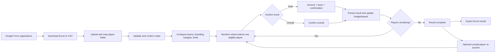
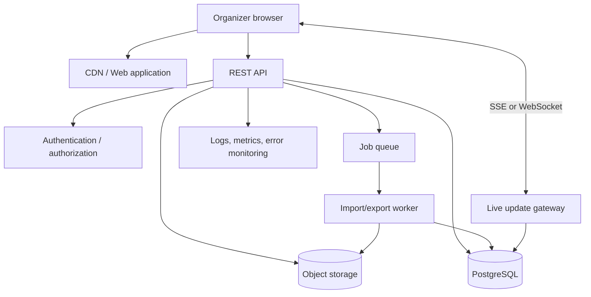
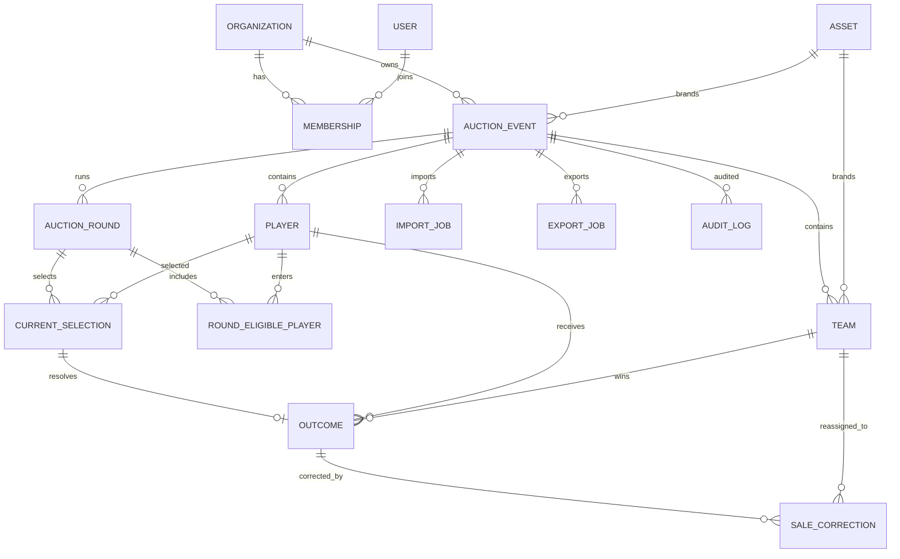

# Auction House — Full Product, Frontend, Backend, and Database Plan

Version 1.0  
Prepared: 16 October 2026  
Reference product: [NeoAuction](https://neoauction.vercel.app/)  
Target product: organizer-operated sports player auction

## 1. Executive summary

Auction House will manage the auction after player registration is complete. Registration remains outside the application in Google Forms. The organizer downloads the Google Forms responses as Excel or CSV, uploads the file, selects which columns the auction needs, validates the players, configures teams and budgets, and conducts the auction.

The core live flow is:



The recommended production architecture is a React frontend, a transactional API, PostgreSQL, object storage for logos/photos, background jobs for large imports/exports, and role-based authentication. The server must be authoritative for random selection, sale validation, budgets, squad limits, and duplicate prevention.

## 2. NeoAuction comparison

### What was verified

An authenticated, read-only review was completed on 16 October 2026. NeoAuction has five primary screens: Auction, Teams, Players, Unsold, and Results. Its auction dashboard presents live team cards with remaining budgets and squad counts beside a central bidding stage. Team management supports add, edit, and delete. Player management uses status filters and player cards. Unsold players have a direct **Auction Now** action. Results show event totals and team-level spending, balances, and squad counts, with CSV export.

The reviewed account had no available players, so the start-bidding control was disabled. The actual active-player selection animation and sold/unsold dialogs could not be exercised without changing the account's auction data. The comparison below therefore distinguishes observed behavior from the required Auction House transaction flow.

### Flow alignment

| Area              | NeoAuction authenticated behavior                                                | Auction House requirement                                                           | Alignment                                                                        |
| ----------------- | -------------------------------------------------------------------------------- | ----------------------------------------------------------------------------------- | -------------------------------------------------------------------------------- |
| Organizer access  | Email/password sign-in and organizer profile menu                                | Production system needs secure organizer access                                     | Same production pattern; authentication is part of the backend phase             |
| Main navigation   | Auction, Teams, Players, Unsold, Results                                         | The same five operational areas, plus Import and Settings utilities                 | Aligned                                                                          |
| Auction dashboard | Live team rail, remaining budgets, squad counts, central bidding stage           | Live team rail, persisted random selection, player spotlight, outcome controls      | Aligned; Auction House adds explicit wheel and transaction safeguards            |
| Registration      | Player page exposes manual Add Player and a hosted Form Builder/share flow       | Registration stays in Google Forms outside the product                              | Deliberately different to match the stated requirement                           |
| Player import     | No spreadsheet import control was visible in the reviewed screens                | Excel/CSV upload, mapping, validation, and selective retention                      | Auction House adds the required workflow                                         |
| Teams             | Add, edit, and delete controls; cards show spent, remaining, and player capacity | Add/edit/delete teams with name, logo, color, budget, and capacity                  | Aligned                                                                          |
| Players           | All, Available, Sold, and Unsold filters; edit/delete player cards               | Searchable/filterable roster with profile maintenance and status                    | Aligned                                                                          |
| Selection         | Start Bidding exists but was disabled because no players were available          | Random, persisted, name-free wheel over eligible players                            | Required flow is implemented; exact NeoAuction animation was not exercised       |
| Outcomes          | Existing player records show sold amount/team or unsold status                   | Sold requires amount and team; unsold requires confirmation; supports points or INR | Aligned at outcome level; Auction House adds unit choice and strict validation   |
| Retry rounds      | Unsold page provides Auction Now for every unsold player                         | Re-auction all unsold players as a new round without resetting history              | Same user goal with a round-based model that preserves fairness and auditability |
| Results           | Totals, sold/unsold/available counts, spend, team summaries, and CSV export      | Team/player summaries and five-sheet Excel export with audit history                | Aligned; Auction House provides the richer requested export                      |

The current Auction House interface matches NeoAuction's operational structure and improves the requested organizer flow. An organizer imports the external Google Forms workbook, confirms only the mapped fields, configures branded teams, spins for a random eligible player, records sold or unsold, proceeds to the next player, optionally re-auctions an unsold round, and exports the completed workbook. NeoAuction-specific Form Builder, Copy Link, and WhatsApp registration controls are intentionally excluded because registration happens outside this system.

## 3. Scope and actors

### Primary actor

**Organizer/Admin**

- Creates and configures an event.
- Uploads the registration workbook.
- Maps and confirms player data.
- Adds and manages teams.
- Runs the live auction.
- Corrects mistakes with an audit trail.
- Exports final results.

### Optional later actors

- **Auction operator:** can run selections and record outcomes but cannot change event setup or users.
- **Viewer/projector:** read-only live auction display.
- **Super admin:** manages organizations, subscriptions, and support. This is unnecessary for the first organization-owned release.

### In scope

- Google Forms Excel/CSV import.
- Selective player-field retention.
- Team branding, budgets, and squad limits.
- Points or INR event unit.
- Random player selection and wheel animation.
- Sold and unsold processing.
- Automatic or manual next selection.
- Repeated unsold-player rounds.
- Sale corrections with audit history.
- Live team balances and squads.
- Final Excel export.
- Authentication, authorization, shared persistence, recovery, and auditability for the production system.

### Out of scope for the first release

- Creating or editing Google Forms.
- Direct Google Forms API synchronization.
- Public bidder accounts and online bidding.
- Payment collection.
- Automatic bid increments.
- Team-owner bidding devices.
- Video streaming.
- Native mobile applications.

## 4. Complete product flow

### 4.1 Account and organization setup

1. An administrator creates an organization or receives an invitation.
2. The user signs in with email/password or a configured identity provider.
3. The user creates an auction event with name, season, timezone, default unit, and optional logo.
4. The system creates an event in `DRAFT` state.
5. The organizer can invite another organizer/operator if multi-user operation is enabled.

### 4.2 Registration import

1. Player registration occurs in Google Forms.
2. The organizer downloads `.xlsx` or `.csv` responses.
3. On the Import screen, the organizer uploads the file.
4. The backend stores the upload temporarily and scans/validates its type and size.
5. The system reads worksheet names and previews rows.
6. The organizer selects the worksheet and header row.
7. The system suggests mappings for:
   - Registration code (optional)
   - Player name (required)
   - Role
   - Category
   - Age
   - City
   - Photo URL
8. The organizer edits mappings and sees excluded columns explicitly.
9. The system validates all included rows. It does not silently import a valid subset.
10. The organizer confirms the import.
11. In one transaction, the backend creates normalized players, records import metadata, and discards unmapped raw values.
12. Email, phone, jersey size, and other unrelated registration fields do not enter the player database or result exports unless deliberately added to the product schema later.

### 4.3 Team setup

The organizer can create and edit teams with:

- Team name
- Short name
- Logo
- Brand color
- Starting budget for points
- Starting budget for INR
- Maximum squad size

Delete is allowed only when a team has no active selection reference and no outcome or correction history. A team with historical use is archived or retained rather than hard-deleted.

### 4.4 Auction setup review

Before the first player is selected, show a review step:

- Event and season
- Active unit: points or INR
- Player count
- Team count
- Each team’s starting budget and squad limit
- Auto-next preference

The organizer confirms the setup. After the first saved outcome, the active unit and existing starting budgets are locked.

### 4.5 Random player selection

1. The organizer presses **Start auction** or **Spin next player**.
2. The frontend sends a selection command with the current event revision/idempotency key.
3. The backend locks the event/round, builds the latest eligible pool, uses cryptographically secure unbiased randomness, creates one current selection, and commits it.
4. The backend returns the persisted player selection.
5. The frontend runs a decorative wheel animation containing no player names.
6. After animation, the separate player spotlight reveals the selected player.
7. Refreshing or opening another authorized display shows the same current player.

The browser animation never decides the winner. It visualizes a winner already committed by the server.

### 4.6 Sold flow

1. Enter the final sold amount.
2. Select the winning team.
3. Validate:
   - Amount is positive.
   - Points are whole numbers.
   - INR has at most two decimals.
   - Team has sufficient remaining budget.
   - Team has an available squad slot.
   - Player is still the unresolved current selection.
4. Show a confirmation containing player, team, amount, current and resulting balance, and resulting squad count.
5. On confirmation, the backend revalidates inside one database transaction.
6. Create the sold outcome, allocate the player, clear the current selection, update the event revision, and publish a live update.
7. If auto-next is enabled and eligible players remain, the client schedules exactly one next selection after brief feedback.

### 4.7 Unsold flow

1. Press **Mark unsold**.
2. Confirm the player name and unsold outcome.
3. Save an outcome with no team and no amount.
4. Clear the current selection.
5. Team budgets and squads remain unchanged.
6. Continue automatically or manually.

### 4.8 Round completion and re-auction

When every eligible player in the current round has an outcome:

- Mark the round complete.
- Show sold, unsold, allocated total, and team summaries.
- Enable final export for the current completed state.
- If unsold players exist, offer **Auction unsold players**.

Starting another round creates a new immutable eligible list containing only players whose current final status is unsold. It does not clone players or reset outcomes, budgets, squads, or history. Starting a retry round temporarily disables final export until that round completes.

### 4.9 Corrections

When no player is active, an authorized organizer can correct a sold player’s team and/or amount:

1. Load the effective current allocation.
2. Temporarily refund its amount and free its slot for validation.
3. Validate the replacement allocation.
4. Show old and new values for review.
5. Save an immutable correction record in the same transaction.
6. Recompute effective team totals from the original outcome plus corrections.

Past outcomes are never edited or deleted.

### 4.10 Export

Generate a real `.xlsx` workbook after a round is complete:

1. Player Results
2. Team Allocations
3. Unsold Players
4. Summary
5. Auction History

Export only normalized system fields. Monetary cells remain numeric; INR is exported in rupees with two decimals. Text that begins with `=`, `+`, `-`, or `@` must remain literal and cannot become a spreadsheet formula.

## 5. Functional requirements

| ID    | Requirement           | Acceptance condition                                                                                  |
| ----- | --------------------- | ----------------------------------------------------------------------------------------------------- |
| FR-01 | Authentication        | Authorized users can sign in and access only their organization/events.                               |
| FR-02 | Event management      | Organizer can create, edit, archive, and resume an event.                                             |
| FR-03 | External registration | Product does not require players to register in the auction app.                                      |
| FR-04 | XLSX/CSV upload       | Valid Google Forms exports can be previewed and mapped.                                               |
| FR-05 | Selective retention   | Only mapped fields persist; excluded source data is discarded.                                        |
| FR-06 | Import validation     | Invalid rows block the full import with actionable row errors.                                        |
| FR-07 | Team branding         | Add/edit team name, short name, logo, color, budgets, and limit.                                      |
| FR-08 | Safe team deletion    | Historical team references cannot be erased.                                                          |
| FR-09 | Auction unit          | One event uses points or INR; exact integer minor units are stored.                                   |
| FR-10 | Random selection      | Exactly one eligible player is selected uniformly and persisted.                                      |
| FR-11 | Anonymous wheel       | No player name appears in wheel segments, labels, or accessibility text.                              |
| FR-12 | Sold outcome          | Amount and team are reviewed and committed atomically.                                                |
| FR-13 | Unsold outcome        | Outcome contains no team/amount and does not affect budgets.                                          |
| FR-14 | Auto-next             | At most one next selection is scheduled after a successful outcome.                                   |
| FR-15 | Team information      | Starting, spent, remaining, count, and available slots are live.                                      |
| FR-16 | Re-auction            | Only the current unsold pool enters a new round.                                                      |
| FR-17 | Results               | Global final status counts every player once; history retains attempts.                               |
| FR-18 | Corrections           | Refund-before-validation prevents double charging and keeps audit history.                            |
| FR-19 | Excel export          | Five sheets match current effective results and immutable history.                                    |
| FR-20 | Recovery              | Refresh and reconnection recover the same event and current selection.                                |
| FR-21 | Concurrency           | Duplicate clicks/tabs cannot duplicate a selection or overspend.                                      |
| FR-22 | Audit                 | Important configuration, import, selection, outcome, correction, and export actions are attributable. |

## 6. Non-functional requirements

- **Consistency:** sale, correction, and selection commands use database transactions and row locks.
- **Availability:** target 99.9% monthly availability for production.
- **Performance:** normal API reads under 300 ms p95; selection/outcome commands under 700 ms p95 excluding client animation; imports of 1,000 players under 15 seconds.
- **Scalability:** stateless API instances; database connection pooling; background workers for imports/exports; object storage for images.
- **Security:** TLS, secure password hashing or managed identity, role checks on every event operation, rate limiting, CSRF protection for cookie sessions, secure headers, upload limits, MIME/signature validation, and audit logs.
- **Privacy:** raw registration uploads expire after confirmation/error retention window; unmapped fields are never copied into durable player records.
- **Accessibility:** keyboard operation, visible focus, labelled forms, modal focus management, text plus color statuses, screen-reader announcements, and reduced motion.
- **Responsive layout:** no horizontal page overflow; tables and team strips scroll inside their containers; dialogs remain within the viewport.
- **Observability:** structured logs without raw registration data, metrics, traces, error monitoring, and alerts.
- **Recovery:** daily backups, point-in-time database recovery, object lifecycle policies, and tested restore procedure.

## 7. Recommended architecture



### Recommended stack

| Layer            | Recommended choice                                   | Reason                                                                                                                             |
| ---------------- | ---------------------------------------------------- | ---------------------------------------------------------------------------------------------------------------------------------- |
| Frontend         | React + TypeScript + Vite                            | Matches the implemented UI and supports a focused SPA.                                                                             |
| Routing/data     | React Router + TanStack Query                        | Routes plus server-state caching, retries, and invalidation.                                                                       |
| Forms/validation | React Hook Form + Zod                                | Shared validation concepts and accessible error handling.                                                                          |
| Backend          | Node.js + TypeScript + Fastify                       | Fast, schema-driven API with a small operational surface. NestJS is acceptable if the team prefers stronger framework conventions. |
| Database         | PostgreSQL                                           | Transactions, constraints, row locks, JSON metadata, and reporting.                                                                |
| ORM/migrations   | Prisma or Drizzle                                    | Typed queries and explicit migrations. Use raw SQL for locking/critical commands where helpful.                                    |
| Queue            | Redis + BullMQ                                       | Background import/export and retry control. For small launch scale, synchronous import can precede this.                           |
| Files            | S3-compatible object storage                         | Durable logos, event images, temporary uploads, and generated exports.                                                             |
| Live updates     | Server-Sent Events initially                         | Simple one-way event updates for projector/multiple tabs. WebSocket is needed only for richer two-way live bidding later.          |
| Auth             | Managed OIDC/Auth provider or secure cookie sessions | Avoid building password recovery/MFA from scratch unless required.                                                                 |
| Spreadsheet      | SheetJS CE adapter                                   | Real XLSX/CSV parsing and generation behind one service.                                                                           |
| Tests            | Vitest + API integration tests + Playwright          | Rules, transactions, and real browser workflows.                                                                                   |
| Infrastructure   | Docker + managed PostgreSQL/object storage           | Reproducible deployment with fewer stateful services to operate.                                                                   |

### Monorepo layout

```text
auction-house/
  apps/
    web/                 React frontend
    api/                 Fastify API
    worker/              import/export jobs
  packages/
    domain/              shared types, money, rules, schemas
    database/            schema, migrations, repositories
    spreadsheet/         import/export adapter
    ui/                  reusable UI components and tokens
    config/              lint, TypeScript, test configuration
  infrastructure/
    docker/
    terraform/           optional infrastructure as code
  docs/
    architecture/
    runbooks/
  tests/
    e2e/
```

The existing browser-local application can become `apps/web`. Its pure domain rules and spreadsheet adapter can move into shared packages. Browser-local storage remains useful for offline demos, but production writes must go through the API.

## 8. Frontend plan

### Routes

| Route                       | Purpose                                                                |
| --------------------------- | ---------------------------------------------------------------------- |
| `/login`                    | Sign in and password recovery/SSO entry.                               |
| `/events`                   | Event list and create/resume actions.                                  |
| `/events/:eventId/auction`  | Live auction stage and team rail.                                      |
| `/events/:eventId/import`   | Upload, worksheet/header selection, mapping, validation, confirmation. |
| `/events/:eventId/teams`    | Team CRUD, branding, budgets, limits, squads.                          |
| `/events/:eventId/players`  | Search, filter, add/edit/delete under lock rules.                      |
| `/events/:eventId/unsold`   | Retry pool and start-round confirmation.                               |
| `/events/:eventId/results`  | Results, summaries, corrections, export.                               |
| `/events/:eventId/settings` | Event identity, unit, display, and permissions.                        |
| `/display/:publicToken`     | Optional later read-only projector view.                               |

### Frontend state boundaries

- **Server state:** event snapshot, players, teams, rounds, outcomes, permissions. Managed through query caching and invalidated by server events.
- **Transient state:** wheel animation, unsaved amount/team, open dialog, filters, search, and toast messages.
- **Local preference:** collapsed rail and reduced-density preference.
- **Never duplicate as writable state:** spent, remaining, squad count, final status, or progress. These are projections from server data.

### Important UI states

- Initial loading and storage/network error
- Empty event setup
- Import uploaded but not confirmed
- Auction ready
- Selection committed and wheel spinning
- Player revealed
- Confirmation open
- Saving outcome
- Save conflict/stale revision
- Round complete
- Retry round active
- Export building/ready/error
- Reconnecting/live update paused

## 9. Backend plan

### Service modules

- `auth`: identity, sessions/tokens, invitations, roles.
- `organizations`: tenancy and membership.
- `events`: event lifecycle and configuration locks.
- `players`: normalized profiles and setup rules.
- `imports`: upload sessions, parsing, mapping, validation, atomic confirmation.
- `teams`: branding, budgets, capacities, archive/delete rules.
- `auction`: rounds, secure selection, sold/unsold commands, progression.
- `corrections`: refund-before-validation changes.
- `results`: projections, summaries, history.
- `exports`: workbook creation and download lifecycle.
- `assets`: signed uploads/downloads, validation, lifecycle.
- `audit`: append-only activity records.
- `live`: SSE/WebSocket subscriptions and event notifications.

### Command transaction pattern

Every mutation receives:

- Authenticated actor
- Organization/event identifier
- Expected event revision
- Idempotency key
- Command payload

Within a transaction:

1. Verify membership and permission.
2. Lock the event row (`SELECT ... FOR UPDATE`).
3. Reject stale revision or return the previous response for a repeated idempotency key.
4. Read authoritative players, teams, round, outcomes, and corrections.
5. Revalidate the complete command.
6. Append immutable records/change mutable setup entities.
7. Increment event revision.
8. Write audit event and outbox notification.
9. Commit.

The live notification is sent from an outbox worker after commit, avoiding messages for rolled-back transactions.

## 10. API design

Prefix: `/api/v1`

### Authentication and organizations

```text
POST   /auth/login
POST   /auth/logout
POST   /auth/refresh
GET    /me
GET    /organizations
POST   /organizations/:orgId/invitations
PATCH  /organizations/:orgId/members/:memberId
```

### Events and setup

```text
GET    /events
POST   /events
GET    /events/:eventId
PATCH  /events/:eventId
POST   /events/:eventId/archive
POST   /events/:eventId/reset
GET    /events/:eventId/snapshot
GET    /events/:eventId/stream
```

### Imports

```text
POST   /events/:eventId/imports
GET    /events/:eventId/imports/:importId
PATCH  /events/:eventId/imports/:importId/mapping
POST   /events/:eventId/imports/:importId/validate
POST   /events/:eventId/imports/:importId/confirm
DELETE /events/:eventId/imports/:importId
```

Upload may use a signed object-storage URL. `confirm` carries the expected event revision and atomically replaces the setup roster.

### Teams and players

```text
GET    /events/:eventId/teams
POST   /events/:eventId/teams
PATCH  /events/:eventId/teams/:teamId
DELETE /events/:eventId/teams/:teamId
GET    /events/:eventId/teams/:teamId/squad

GET    /events/:eventId/players
POST   /events/:eventId/players
PATCH  /events/:eventId/players/:playerId
DELETE /events/:eventId/players/:playerId
```

### Auction commands

```text
POST   /events/:eventId/rounds/main
POST   /events/:eventId/selections
POST   /events/:eventId/selections/:selectionId/sold
POST   /events/:eventId/selections/:selectionId/unsold
POST   /events/:eventId/rounds/unsold
```

Example sold request:

```json
{
  "expectedRevision": 27,
  "idempotencyKey": "a5a6b46f-...",
  "teamId": "team_123",
  "amount": "1250.50"
}
```

The API parses the amount string into integer minor units. It does not accept a client-calculated balance.

### Results and exports

```text
GET    /events/:eventId/results
GET    /events/:eventId/history
POST   /events/:eventId/outcomes/:outcomeId/corrections
POST   /events/:eventId/exports
GET    /events/:eventId/exports/:exportId
GET    /events/:eventId/exports/:exportId/download
```

### Error contract

```json
{
  "error": {
    "code": "TEAM_BUDGET_EXCEEDED",
    "message": "Royal Strikers has only 750 pts remaining.",
    "fieldErrors": { "amount": "Enter an amount within the remaining budget." },
    "currentRevision": 28,
    "requestId": "req_..."
  }
}
```

Use stable machine codes for client behavior and clear messages for organizers.

## 11. Database design

All primary keys should be UUID/ULID. All tenant-owned tables include `organization_id` directly or through a constrained event relationship. Store timestamps in UTC.



### Core tables

#### `organizations`

- `id`
- `name`
- `slug` unique
- `created_at`, `updated_at`

#### `users`

- `id`
- `email` unique normalized
- identity-provider/password fields as applicable
- `status`
- `created_at`, `last_login_at`

#### `memberships`

- `organization_id`
- `user_id`
- `role`: `ADMIN`, `ORGANIZER`, `OPERATOR`, `VIEWER`
- unique `(organization_id, user_id)`

#### `auction_events`

- `id`, `organization_id`
- `name`, `season`, `timezone`
- `unit`: `POINTS` or `INR`
- `status`: `DRAFT`, `READY`, `ACTIVE`, `COMPLETED`, `ARCHIVED`
- `revision` integer
- `configuration_locked` boolean
- `current_round_id` nullable
- `event_logo_asset_id` nullable
- display/auto-next preferences
- `created_by`, `created_at`, `updated_at`

#### `players`

- `id`, `organization_id`, `event_id`
- `registration_code`
- `name`, `role`, `category`, `age`, `city`, `photo_url`
- `source_row`, `created_at`, `updated_at`
- unique `(event_id, normalized_registration_code)`

Do not add a mutable auction-status column. Compute final/current status from rounds, selection, outcomes, and corrections.

#### `teams`

- `id`, `organization_id`, `event_id`
- `name`, `short_name`, `color`, `logo_asset_id`
- `points_budget_minor`, `inr_budget_minor`
- `max_players`
- `archived_at` nullable
- unique `(event_id, normalized_name)`

#### `auction_rounds`

- `id`, `event_id`, `number`
- `kind`: `MAIN`, `UNSOLD`
- `status`: `READY`, `ACTIVE`, `COMPLETED`
- `started_at`, `completed_at`
- unique `(event_id, number)`

#### `round_eligible_players`

- `round_id`, `player_id`
- unique `(round_id, player_id)`

This immutable join table proves who was eligible for each round.

#### `current_selections`

- `id`, `event_id`, `round_id`, `player_id`
- `selected_at`, `resolved_at` nullable
- partial unique index allowing only one unresolved selection per event
- unique `(round_id, player_id)` where appropriate

Keeping resolved selection records supports audit/recovery; `resolved_at IS NULL` identifies the current one.

#### `outcomes`

- `id`, `event_id`, `round_id`, `selection_id`, `player_id`
- `status`: `SOLD`, `UNSOLD`
- `team_id` nullable
- `amount_minor` nullable
- `unit`
- `sequence`
- `player_name_at_time`, `team_name_at_time`
- `completed_by`, `completed_at`
- unique `selection_id`
- unique `(round_id, player_id)`
- check constraint: sold requires team and positive amount; unsold requires both null

#### `sale_corrections`

- `id`, `event_id`, `target_outcome_id`
- `previous_team_id`, `previous_amount_minor`
- `next_team_id`, `next_amount_minor`
- previous/next team name snapshots
- `reason`, `sequence`, `corrected_by`, `corrected_at`

#### `import_jobs`

- `id`, `event_id`, uploader and object key
- original filename, size, checksum
- selected worksheet/header row
- mapping JSON (column names only)
- excluded column names
- state and validation summary
- `expires_at`, `confirmed_at`

Do not store raw rows in a general JSON column after confirmation. Temporary upload and parse artifacts must expire.

#### `assets`

- `id`, `organization_id`, object key
- media type, byte size, checksum, dimensions
- uploader and timestamps

#### `export_jobs`

- `id`, `event_id`, requested revision
- status, object key, checksum
- requested/completed timestamps, error code

#### `idempotency_keys`

- organization/user scope
- key, command type, request hash
- response code/body or referenced resource
- `expires_at`
- unique scoped key

#### `audit_logs`

- actor, organization, event
- action, target type/id
- safe before/after summary
- request ID, IP/user agent if policy permits
- timestamp

Never include raw registration rows, passwords, tokens, or private excluded fields in audit logs.

### Derived team allocation query

For each sold outcome, apply its latest correction by sequence. Then:

```text
spent = sum(effective amount_minor for team)
remaining = configured budget_minor - spent
player_count = count(effective sold allocations for team)
slots_remaining = max_players - player_count
```

Use the same query/service for API views, command validation, results, and export. Do not keep independently editable totals.

## 12. Security and privacy plan

- Enforce organization/event authorization in the backend; hiding buttons is not security.
- Use secure, HTTP-only, SameSite cookies for web sessions or short-lived access tokens with secure rotation.
- Hash passwords with Argon2id when passwords are owned by the product; prefer a managed identity provider for MFA and recovery.
- Rate-limit login, import, selection, outcome, correction, and export endpoints.
- Require idempotency keys for critical commands.
- Validate file extensions, MIME types, signatures, decompressed size, row count, worksheet count, and image decoding.
- Reject `.xlsm`, macros, executables, and unsupported archives.
- Treat cells as plain data. Sanitize spreadsheet exports against formula injection.
- Use signed object-storage URLs with short expiry and tenant-scoped keys.
- Encrypt transport and managed storage; protect secrets in a secret manager.
- Keep temporary registration uploads for the shortest practical time, such as 24 hours for failed/unconfirmed jobs and immediate deletion after confirmed normalization if operationally safe.
- Define retention and deletion rules for archived events and audit logs.
- Back up PostgreSQL and test restoration. Database backups do not substitute for result exports.

## 13. Concurrency and correctness

Critical cases:

- Two organizers press Spin: one transaction creates the selection; the other receives the current selection/conflict.
- Sold is double-clicked: unique selection outcome plus idempotency returns one result.
- Two teams attempt conflicting updates: event row lock and revision revalidation serialize changes.
- Correction and new sale occur together: both validate against locked, current effective allocations.
- Client loses connection after commit: retry with the same idempotency key returns the committed response.
- Live update arrives during wheel animation: client cancels stale animation/form and displays the server state.

Suggested transaction isolation is PostgreSQL `READ COMMITTED` with explicit event row locking. Serializable isolation may be used for critical commands if operational testing supports its retry behavior.

## 14. Testing and acceptance plan

### Domain tests

- Exact points and INR parsing, including ₹0.10 + ₹0.20 = ₹0.30.
- Safe integer limits and no floating-point accumulation.
- Uniform eligible-pool selection boundaries.
- Budget equality allowed; overspend rejected.
- Capacity equality/full-team behavior.
- Duplicate outcome and sold-player prevention.
- Unsold has null team/amount.
- Retry rounds preserve sold allocations/history.
- Corrections refund before validating.

### API/database integration tests

- Revision conflict and idempotency.
- Concurrent Spin requests.
- Concurrent duplicate sale requests.
- Rollback on budget/capacity/correction failure.
- Tenant isolation.
- Import confirmation atomicity and raw-data deletion.
- Migration forward/backward safety.
- Outbox event appears only after commit.

### Browser tests

- Login and permission restrictions.
- Real XLSX/CSV uploads, alternate worksheet/header, mapping, preview, errors.
- Team/player/logo workflows.
- Full main round and multiple unsold rounds.
- Refresh during selection.
- Auto-next on/off, route exit, network failure, stale update.
- Sale correction and audit history.
- Excel download and read-back.
- Desktop, tablet, mobile, keyboard-only, and reduced-motion behavior.

### Production readiness tests

- Load test live snapshots and command endpoints.
- Dependency and container vulnerability scanning.
- Backup restore rehearsal.
- Object-storage lifecycle verification.
- Logging/privacy review proving excluded registration fields are absent.
- Disaster and rollback runbooks.

## 15. Delivery phases

### Phase 0 — Discovery and decisions (1 week)

- Confirm organizations, user roles, expected concurrent viewers, branding, retention, hosting region, and recovery targets.
- Obtain an authorized NeoAuction test account or recording if exact parity is required.
- Freeze the MVP acceptance matrix.

### Phase 1 — Full-stack foundation (1–2 weeks)

- Create monorepo, API, database migrations, environments, CI, authentication, organization/event authorization, logging, and health checks.
- Move shared domain rules from the current frontend into a server-usable package.

### Phase 2 — Setup and import (2 weeks)

- Events, teams, players, assets, upload sessions, mapping/validation, atomic roster confirmation, privacy lifecycle, and setup review.

### Phase 3 — Authoritative auction engine (2 weeks)

- Transactional rounds, secure selection, sold/unsold commands, derived budgets/squads, revision/idempotency, live updates, and frontend integration.

### Phase 4 — Retry rounds, corrections, results (1–2 weeks)

- Unsold pools, repeated rounds, result projections, correction audit, history, permissions, and projector-ready live updates.

### Phase 5 — Export and operational hardening (1–2 weeks)

- Background five-sheet exports, signed downloads, monitoring, rate limiting, backups, restore tests, privacy review, and load/security checks.

### Phase 6 — UAT and release (1 week)

- Organizer acceptance rehearsal using a realistic registration file and full auction.
- Fixes, production migration, operator guide, support runbook, and controlled launch.

A focused team can target an MVP in roughly 8–10 weeks after requirements are frozen. A single developer should plan more time, especially for authentication, infrastructure, concurrency testing, and operations.

## 16. Environments and deployment

- **Local:** Docker Compose with PostgreSQL, Redis, object-storage emulator, API, worker, and web.
- **Development:** shared non-production services and synthetic data only.
- **Staging:** production-like, separate credentials/storage, anonymized fixtures, release candidate testing.
- **Production:** managed PostgreSQL with PITR, managed object storage, Redis/queue, autoscaled or appropriately sized API/worker, CDN, TLS, monitoring, and alerting.

CI pipeline:

1. Install from lockfile.
2. Format/lint/typecheck.
3. Domain and API tests.
4. Build web/API/worker.
5. Container and dependency scan.
6. Start ephemeral database and run integration/browser tests.
7. Publish immutable artifacts.
8. Apply migrations with a reviewed deployment step.
9. Deploy staging, run smoke checks, then promote the same artifacts to production.

Database migrations should be backward-compatible for rolling deployments. Destructive cleanup follows a later release after old code is no longer running.

## 17. MVP definition of done

- Authorized organizers can create and resume events.
- Google Forms XLSX/CSV data is mapped, validated, normalized, and privacy-safe.
- Team branding, budgets, and limits work with safe history rules.
- The server selects each eligible player once with unbiased randomness.
- The wheel never exposes names and never decides the winner.
- Sold/unsold commands are atomic, idempotent, and concurrency-safe.
- Points and INR balances are exact.
- Refresh/multiple tabs recover current state without duplicates.
- Repeated unsold rounds preserve all prior sales and attempts.
- Corrections safely reallocate and retain audit history.
- Five-sheet Excel export matches visible final results.
- Responsive and accessible organizer flows pass browser tests.
- Authorization, upload security, monitoring, backups, and recovery are operationally verified.
- Documentation covers organizer use, architecture, API, database, deployment, and incident recovery.

## 18. Decisions to finalize before backend implementation

These choices do not block understanding the product, but should be fixed before engineering estimates become commitments:

1. Single organization or multi-tenant SaaS.
2. Email/password, Google sign-in, Microsoft sign-in, or enterprise SSO.
3. Organizer-only operation or separate operator/viewer roles in MVP.
4. Maximum players, teams, event history retention, and image storage limits.
5. Whether a public/projector view is part of MVP.
6. Required hosting region and compliance/privacy policy.
7. Backup recovery point and recovery time targets.
8. Whether exports must be retained server-side or generated for immediate download only.

The safest initial production choice is one organization, admin/organizer/operator/viewer roles, managed authentication, PostgreSQL, S3-compatible storage, SSE live updates, no public bidding, and exports retained for a short configurable period.
